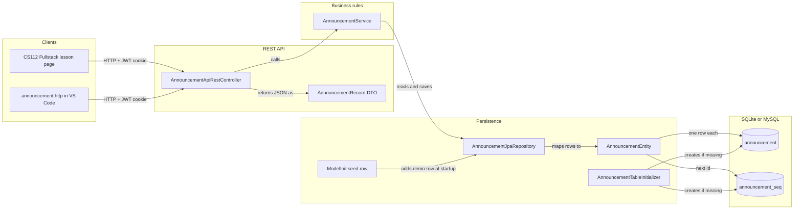

# Announcement Architecture Guide

## Overview

Announcements are short posts with an author, a title, a body and a tag. The API lets a signed-in account create them, read them in a few ways, edit a body, and delete one.

The package is a small, complete example of the five standard parts every Spring feature in this repository has. It is the API the CS112 Fullstack lessons call. The class announcements and week chat on the course site do **not** use it: those are group chats under `/api/groups` and the `/ws-chat` WebSocket (`mvc/groups`).

| Area | Location | Notes |
|---|---|---|
| Java implementation | `src/main/java/com/open/spring/mvc/announcement/` | The five standard parts, below. |
| Tests | `src/test/java/com/open/spring/mvc/announcement/` | Service behavior and the JSON contract. |
| HTTP tests | `api/announcement.http` | Every route, for the VS Code REST Client. |
| Public routes | `/api/announcements/...` | A contract with existing clients. Keep them unchanged. |

## The five standard parts

| Part | Class | What it does |
|---|---|---|
| REST controller | `AnnouncementApiRestController` | Ingress and egress: turns HTTP requests into service calls and service results into HTTP responses. It holds no business rules. |
| Entity | `AnnouncementEntity` | A plain Java object (POJO) that `@Entity` maps to the `announcement` table. One object is one row. |
| JPA repository | `AnnouncementJpaRepository` | The interface Java uses to read and write the table. Spring Data writes the SQL from method names such as `findByTitle`. |
| Service | `AnnouncementService` | The business rules. It is the only class that uses the repository. |
| Table initializer | `AnnouncementTableInitializer` | A fallback that creates the tables if they are missing, because Hibernate runs with `ddl-auto=none`. |

The controller also owns one DTO, the nested `AnnouncementRecord`.

## How a request flows through the layers

### Records, DTOs and entities

A Java `record` is a short, read-only class. Here it is a data transfer object (DTO): the shape of data going in or out of the API, not a table.

1. **Request in.** Create takes query parameters (`author`, `title`, `body`, `tags`), and edit takes a plain-text body, so these routes need no request DTO.
2. **Service to entity.** The service builds an `AnnouncementEntity` and stamps its `timestamp`. The entity has things a client never sends: the database `id` and the timestamp.
3. **Entity to SQL.** The repository saves the entity, and Hibernate writes it as a row in `announcement`. The id comes from `announcement_seq`.
4. **Response out.** The controller copies the saved entity into an `AnnouncementRecord`, and Jackson turns the record into JSON.

The record's components keep the entity's field names and order, so the JSON is the same as before the API had a DTO: `{"id", "author", "title", "body", "timestamp", "tags"}`. `AnnouncementRecordJsonTest` checks it.

## REST operations

Every route needs a signed-in account (the JWT cookie from `POST /authenticate`), through the shared `/api/**` rule in `SecurityConfig`. A request without one gets 401.

| Method | Route | Operation | Success | Other results |
|---|---|---|---|---|
| POST | `/api/announcements/create?author=&title=&body=&tags=` | Create an announcement | 201 + record | 400 if a parameter is missing |
| GET | `/api/announcements` | Read every announcement | 200 + array | |
| GET | `/api/announcements/orderedByTime` | Read every announcement, newest first | 200 + array | |
| GET | `/api/announcements/author/{author}` | Read the author's announcement | 200 + record | 404 when there is none |
| GET | `/api/announcements/tags/{tags}` | Read announcements whose tags equal the value | 200 + array | empty array when none match |
| POST | `/api/announcements/edit/{title}` | Replace the body (plain-text request body) | 200 + record | 500 when the title doesn't exist |
| POST | `/api/announcements/delete/{title}` | Delete by title | 204 | 500 when the title doesn't exist |

Edit and delete use POST, not PUT and DELETE, and they find an announcement by title, not id. Both are part of the contract, so keep them.

## Persistence

| Table | Columns | Created by |
|---|---|---|
| `announcement` | `id bigint` (primary key), `author`, `body`, `tags`, `timestamp`, `title` (all `varchar(255)`) | Hibernate on a new database, or `AnnouncementTableInitializer` |
| `announcement_seq` | `next_val bigint` | The same. Hibernate keeps the next id here because the entity's id uses `GenerationType.AUTO`. |

- The class is named `AnnouncementEntity`, but `@Entity(name = "Announcement")` and `@Table(name = "announcement")` keep the original names. Hibernate names the id table after the entity name, so without the pin it would look for `announcement_entity_seq`.
- The initializer never changes a table that exists. It adds the first `announcement_seq` row only when both tables are empty, the same row Hibernate's own create adds. If the counter is empty but announcements exist, it logs a warning instead of guessing a value that might repeat an id.
- `timestamp` is text in the form `yyyy-MM-dd HH:mm:ss`, so "newest first" sorts the text.
- `ModelInit` adds one demo announcement ("Test of innit" by Finn) at startup when Finn has none. On a database that was missing the tables, the row appears after the next restart, because `ModelInit` runs before the initializer.

## Testing

- `./mvnw test -Dtest='Announcement*Test'`
  - `AnnouncementServiceTest` covers each service method with a mocked repository.
  - `AnnouncementRecordJsonTest` pins the JSON field names and order.
- `api/announcement.http`: open it in VS Code with the REST Client extension and run the requests in order. Set `baseUrl`, `adminUid` and `adminPassword` under `rest-client.environmentVariables` in the Git-ignored `.vscode/settings.json`. Keep passwords there, never in the `.http` file or a commit. The file deletes the announcement it creates.

## Known issues

These are current behaviors, kept on purpose so that moving the code into the five parts changed nothing a client sees. Fix them in their own change, and update this guide, the tests and `announcement.http` with it.

- **A missing title gives 500, not 404.** Edit throws a `NullPointerException` and delete catches its own error, so both answer 500.
- **Titles and authors are assumed unique.** `findByTitle` and `findByAuthor` return one row. If two announcements share a title, edit and delete fail with 500. If an author has two announcements, `/author/{author}` fails with 500.
- **The client chooses the author.** `author` is a query parameter, so anyone signed in can post under any name. Other features, such as Toolchain, take identity from the signed-in account instead.
- **Any signed-in account can create, edit and delete.** No route checks for a teacher or admin role.
- **Edit replaces only the body.** The title, author and tags can't be changed after creation.

## Change checklist

- Keep each responsibility in its layer: HTTP in the controller, rules in the service, transport shapes in records, table mapping in the entity.
- Keep the routes, the record's component names and order, and the status codes. Update `AnnouncementRecordJsonTest` and `announcement.http` if a contract change is coordinated with its clients.
- When a column changes, update the entity and the initializer's `CREATE TABLE` together, for both SQLite and MySQL.
- Add or update service tests for new behavior, and keep JavaDoc short and in plain prose.
- Update this guide when behavior changes. `README.md` and `AGENTS.md` link here.
