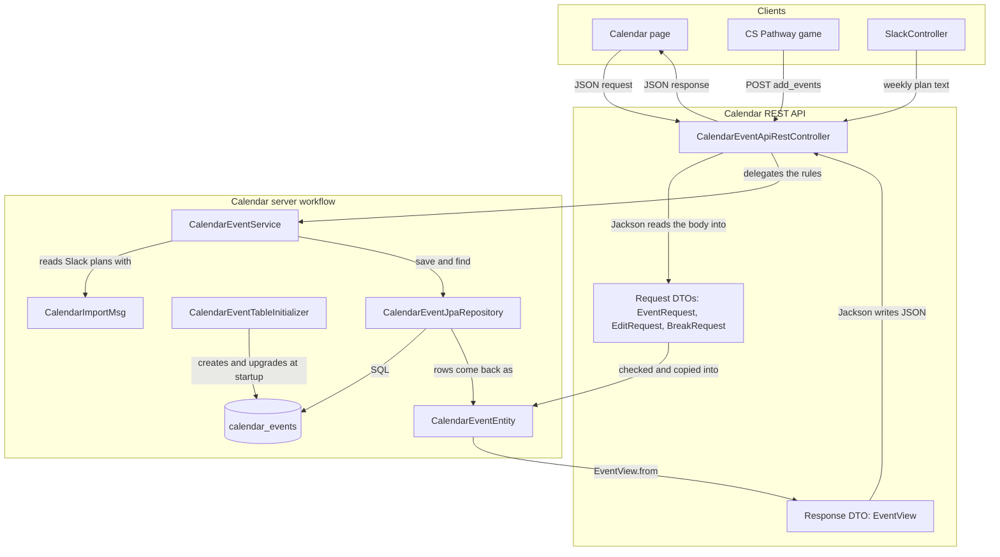
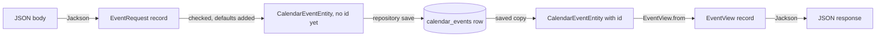

# Calendar Architecture Guide

## Overview

The calendar backend stores three kinds of rows in the `calendar_events` table:

- **Events**: class events, check-ins and grades, such as a sprint review. Events with no owner are visible to everyone.
- **Appointments**: a student's booking with a class period (`classPeriod` such as `P3`), at most four per period per day.
- **Breaks**: a day with no school. Creating one can move that day's events to the next school day.

The calendar page (`_projects/systems/calendar` in pages) and the CS Pathway game call `/api/calendar`. `SlackController` passes every Slack message to `/add`, where `CalendarImportMsg` turns weekly-plan lines into events. `SprintDateService` saves sprint events through the repository.

## The five standard files

The calendar follows the `mvc/toolchain` layout in `src/main/java/com/open/spring/mvc/calendar/`:

| File | Job |
| --- | --- |
| `CalendarEventApiRestController` | Ingress and egress: JSON in, JSON out. Holds the DTO records. |
| `CalendarEventEntity` | A POJO with `@Entity`: one row of `calendar_events`. |
| `CalendarEventJpaRepository` | Reads and writes the table. Spring Data writes the SQL from the method names. |
| `CalendarEventService` | The rules: duplicates, visibility, filters, breaks. |
| `CalendarEventTableInitializer` | Creates or upgrades the table at startup, because `ddl-auto` is `none`. |

`CalendarImportMsg` sits beside them: it reads a Slack weekly plan (`Week of 10/26/2026`, then lines like `[Mon]: Sprint review` or `[Tue - Wed]: *Check-ins`) and returns the events for the service to save. `*` marks a check-in, `**` a grade, and a `•` line adds to the description above it.

<!-- mermaid-checked: no \n, no em-dash/en-dash, no {} in labels, subgraphs are id["label"], arrows are -->|"label"|, all subgraphs closed by end, ids unique -->

## DTOs, records and the entity

A DTO (data transfer object) is the shape data has while it travels as JSON. It is not the database row.

- `CalendarEventEntity` is a **class**, because JPA needs one: it creates an empty object, fills it from a row, and the service later changes it with setters and saves it again.
- The DTOs are **records**. A record is one line listing its fields; Java writes the constructor and accessors (`title()`), and it can't be changed after it is built. That fits data in transit, and it's why a record can't be an entity.

<!-- mermaid-checked: no \n, no em-dash/en-dash, no {} in labels, subgraphs are id["label"], arrows are -->|"label"|, all subgraphs closed by end, ids unique -->

For `POST /api/calendar/add_event`: Jackson matches each JSON property to the `EventRequest` component with the same name. The controller checks it and adds defaults (`type` is `event`, `individual` is the signed-in user), then builds a `CalendarEventEntity`. The repository saves the row and the database assigns the `id`. `EventView.from` copies the saved entity into an `EventView`, which Jackson writes back as JSON.

A DTO carries only what its own request or response needs, so it doesn't have to match the entity:

| Field | `EventRequest` (in) | `CalendarEventEntity` (row) | `EventView` (out) |
| --- | --- | --- | --- |
| `id` | No: the database assigns it | Yes | Yes |
| `title`, `description`, `type`, `period`, `classPeriod`, `groupName`, `individual` | Yes | Yes | Yes |
| `date` | `String`, so a bad date gets a clear 400 | `LocalDate` | `LocalDate`, written as `"2026-10-28"` |
| `isBreak`, `name` | No: breaks use `BreakRequest` | Yes | Yes (`break`, `name`) |
| `newTitle` | No; only `EditRequest` has it | No | No |

The API used to send the entity itself, so every column became part of the JSON. `EventView` makes that a choice: the table can gain a column (an owner id for edit checks, say) without clients receiving it. Today `EventView` sends exactly the JSON the entity did, including `"break"`, and `CalendarEventApiRestControllerTest` checks that the two match.

The records are nested in the controller, as in Toolchain. Two bodies stay maps: Slack's message for `/add`, and the short `{"message"}` / `{"error"}` answers.

## REST operations

Every route requires a signed-in account (`/api/calendar/**` in `SecurityConfig`).

| Method | Route | Request DTO | Response |
| --- | --- | --- | --- |
| POST | `/add_event` | `EventRequest` | `EventView` |
| POST | `/add_events` | `BulkEventsRequest` | `BulkEventsResponse` |
| POST | `/add_bulk` | list of `EventRequest` | empty |
| POST | `/add` | Slack message map | empty |
| GET | `/events`, `/events/{date}`, `/events/range`, `/events/filter`, `/events/next-day`, `/events/bulk` | | list of `EventView` |
| GET | `/appointments/count?date&classPeriod` | | `{"count"}` |
| PUT | `/edit/{id}` | `EditRequest`; left-out `type`, `classPeriod`, `groupName` and `individual` keep their values | `{"message"}` |
| DELETE | `/delete/{id}` | | text |
| DELETE | `/delete_event` | `DeleteByTitleRequest` | `{"success", "message"}` |
| DELETE | `/delete_events` | `BulkDeleteRequest` | `BulkDeleteResponse` |
| POST | `/breaks/create` | `BreakRequest` | `{"success", "message", "break": EventView}` |
| PUT | `/breaks/{id}` | `BreakRequest` | `{"success", "message", "break": EventView}` |
| GET | `/breaks`, `/breaks/by-date`, `/breaks/{id}` | | `EventView` or a list of them |
| GET | `/breaks/is-break-day?date` | | `{"isBreakDay"}` |
| DELETE | `/breaks/{id}` | | `{"success", "message"}` |

Test them with the VS Code REST Client and [`api/calendar.http`](../api/calendar.http). It uses the same `baseUrl`, `adminUid` and `adminPassword` variables as `toolchain.http` (set in the Git-ignored `.vscode/settings.json`), writes test events in 2099, and deletes them at the end.

## Persistence

`CalendarEventTableInitializer` runs `CREATE TABLE IF NOT EXISTS calendar_events`, then adds any of `class_period`, `group_name`, `individual`, `is_break` and `name` that are missing (the first version of the table, in `schema_full.txt`, lacks them). It works on SQLite and MySQL. When you add a field to the entity, add its column to the initializer too.

## Known gaps

These are unchanged here and are the next things to fix:

- Anyone signed in can edit or delete any event or break by id; there is no owner or teacher check (UGRC-CSA/Pages#77).
- Delete by title removes every user's events with that title.
- Creating a break with `moveToNextNonBreakDay` (the default) moves everyone's events on that date.
- `CalendarIssue*` (`/api/calendar/issues`) and the admin page controller are still in `mvc/slack`. `SlackController` stays there too: it receives every Slack message, not only weekly plans.
