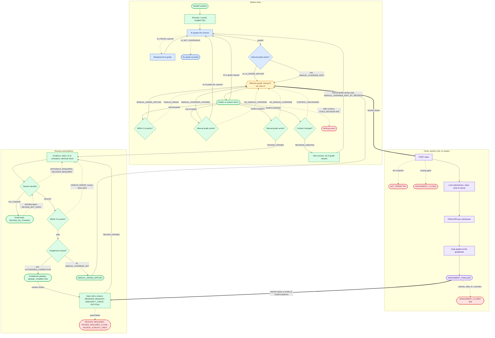

# Grading Architecture Guide

## Overview

Assignment grading covers a submission from the moment it is saved to the last teacher review after the assignment closes:

- **Before close.** Each submission is graded by the AI. Teachers and student teachers (assignment creators and assigned graders) can replace that grade with a manual one, remove it again, or ask for an AI re-grade.
- **Close.** A teacher closes the assignment once. Every grade becomes final and is copied to the gradebook (`SynergyGrade`). There is no reopen.
- **Reviews and petitions.** After close, a grade changes only through a review: a teacher opens one, records evidence and decides. A student can petition their own grade, which a teacher decides the same way.

The code lives in `src/main/java/com/open/spring/mvc/assignments/`. The Spring tracker (`/mvc/assignments/tracker`, `static/js/grading/`) is the teacher UI; students see grades and file petitions on the Pages submissions page (`assets/js/submissions/grading.js`).

## The standard files

Grading follows the `mvc/toolchain` and `mvc/calendar` layout. `AssignmentSubmission`, its `AssignmentSubmissionJPA` repository and `AssignmentSubmissionAPIController` are older and keep their names until the assignments package moves.

| File | Job |
| --- | --- |
| `GradeReviewApiRestController` | `/api/grade-reviews`: reviews and petitions. Holds the request records and the `ReviewView` and `PetitionView` responses. |
| `AssignmentClosureApiRestController` | `POST /api/assignments/{id}/close`. |
| `GradeReviewEntity`, `SubmissionGradeEventEntity` | One row of `assignment_grade_review` and `assignment_submission_grade_event`. |
| `GradeReviewJpaRepository`, `SubmissionGradeEventJpaRepository` | Read and write those tables. |
| `SubmissionGradingService` | The grading rules. Every write to a submission's content or grade goes through it. |
| `AssignmentClosureService`, `FinalGradeTransfer` | Close an assignment, then copy its grades to the gradebook. |
| `GradeReviewService` | Open, petition, collect evidence, decide. |
| `SubmissionAiGrader` | Calls the AI outside any transaction and records the result for the revision it graded. |
| `AssignmentTableInitializer`, `AssignmentSubmissionTableInitializer`, `SubmissionGradeEventTableInitializer`, `GradeReviewTableInitializer` | Create or upgrade each table at startup, because `ddl-auto` is `none`. They share `TableSchema` for the SQLite and MySQL differences. |

Services return a typed `GradingOutcome`. `GradingResponse.statusOf` is the only place an outcome becomes an HTTP status, and the pages hold the text for each one. `GradingOutcomeTextTest` (Spring) and `tests/test_submission_grading.mjs` (Pages) fail if an outcome has no text.

## Lifecycle

Blue is the AI, green is a person, purple is the close, red is a refusal, and amber is the effective grade.

<!-- mermaid-checked: no \n, no em-dash/en-dash, no {} in labels, subgraphs are id["label"], arrows are -->|"label"|, all subgraphs closed by end, ids unique -->

### Resubmitting after a manual grade

A resubmission is a new revision, and the manual grade stays on it. The AI grades the new content in the background and saves its grade next to the manual one (`MANUAL_OVERRIDE_KEPT`), so the grader can compare them, but students keep seeing the manual grade. The history records `REVISED` followed by `MANUAL_OVERRIDE_KEPT_BY_REVISION` at the new revision.

To get the new revision looked at, the student petitions. Before close a student can petition only a manual grade, because an AI grade already follows every revision. After close they can petition any grade. A teacher decides a petition like any other review:

- `NO_CHANGE` keeps the grade.
- `ADJUST` before close sets a new manual grade (`MANUAL_GRADE_APPLIED`). The gradebook is written at close.
- `ADJUST` after close is an `AUTHORIZED_CORRECTION` (`GRADE_CORRECTED`) and updates the gradebook.

A grader can also act on the new revision without a petition: give a new grade, or pick "Use AI grade" to switch to the AI's grade for that revision.

### Rules

- The effective grade (`grade`) is `manualGrade` while `manualOverride` is set, otherwise `aiGrade`.
- `aiGrade` is kept while overridden. It is saved but not effective.
- A manual grade carries over to new revisions. Only a grader removes it.
- Every grading write names its revision. A write for an older revision is refused with `STALE_REVISION` (409), and nothing is saved.
- Only a teacher can close, and there is no reopen. After close, submissions, edits, AI grades (late results included), overrides and re-grade requests are refused with `ASSIGNMENT_CLOSED` (409).
- An AI re-evaluation during a review is stored on the review only and never changes the grade.
- A submission has at most one open review at a time, whether a teacher opened it or a student petitioned.

## REST operations

Every route requires a signed-in account.

| Method | Route | Who | Request | Response |
| --- | --- | --- | --- | --- |
| POST | `/api/submissions/grade/{id}?grade&feedback&revision` | grader | | `GradingResponse` |
| DELETE | `/api/submissions/grade/{id}?revision` | grader | | `GradingResponse` |
| POST | `/api/submissions/ai-grade/{id}` | grader | | `GradingResponse` |
| PUT | `/api/submissions/{id}` | submitter | multipart content | submission |
| GET | `/api/submissions/{id}/grading-history` | grader or submitter | | `GradingHistoryResponse` |
| POST | `/api/assignments/{id}/close` | teacher | | `ClosureResponse` |
| POST | `/api/grade-reviews/submission/{id}` | teacher | `OpenReviewRequest` | `ReviewResponse` |
| POST | `/api/grade-reviews/submission/{id}/petition` | submitter | `PetitionRequest` | `PetitionResponse` |
| GET | `/api/grade-reviews/submission/{id}/petitions` | submitter | | list of `PetitionView` |
| GET | `/api/grade-reviews/submission/{id}` | teacher | | list of `ReviewView` |
| GET | `/api/grade-reviews/assignment/{id}/open` | teacher | | list of `ReviewView` |
| PUT | `/api/grade-reviews/{reviewId}/evidence` | teacher | `EvidenceRequest` | `ReviewResponse` |
| POST | `/api/grade-reviews/{reviewId}/ai-evaluation` | teacher | | `ReviewResponse` |
| POST | `/api/grade-reviews/{reviewId}/similarity` | teacher | | `ReviewResponse` |
| POST | `/api/grade-reviews/{reviewId}/decision` | teacher | `DecisionRequest` | `ReviewResponse` |

`PetitionView` shows the student their message, the decision and its rationale, but not the teacher's evidence, AI re-evaluation or similarity matches.

Test the routes with the VS Code REST Client and [`api/grading.http`](../api/grading.http). It uses `baseUrl`, `adminUid` and `adminPassword` like the other `.http` files, plus `studentUid` and `studentPassword`, all set in the Git-ignored `.vscode/settings.json`. It works on a throwaway `[TEST]` assignment, closes it, and deletes it at the end.

## Persistence and concurrency

- The content and grading columns of `AssignmentSubmission` are mapped `updatable = false`. Never set them on an entity and `save()`; `SubmissionGradingService` changes them with the conditional UPDATEs in `AssignmentSubmissionJPA`.
- Each write takes the row lock first (`lockForGrading`, a no-op UPDATE), because SQLite has no `SELECT ... FOR UPDATE` and a read-then-write transaction fails there with `SQLITE_BUSY`. Close locks the assignment's submissions and then the assignment, the same order every grading path uses.
- Don't save a new `GenerationType.AUTO` entity after taking a lock: its id comes from a sequence table on another connection, which on SQLite waits on that lock. That's why `FinalGradeTransfer` runs after the close or decision commits.
- The table initializers run before the other startup runners. `AssignmentSubmissionTableInitializer` also sorts grades saved before these columns existed into manual or AI, once. When you add a field to one of the entities, add its column to that table's initializer too.
- `SubmissionGradeEventEntity.Type.MANUAL_OVERRIDE_RELEASED_BY_REVISION` stays for history rows written before manual grades carried over to new revisions.

## Tests

`./mvnw test -Dtest='Submission*Test,Grad*Test,Assignment*Test,TableSchemaTest'` runs the grading tests. `SubmissionGradingPersistenceTest` runs the rules, petitions and races against a real SQLite file. Each `*TableInitializerTest` builds its table in an in-memory SQLite database, including from the older shapes of the table. In Pages, `node --test tests/test_submission_grading.mjs` covers the shared grading module.
