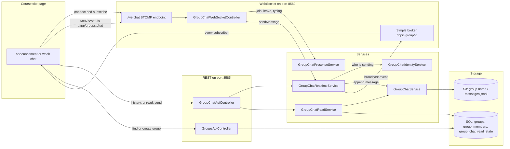

# Group Chat Architecture Guide

## Overview

`mvc/groups` holds two connected features:

- **Groups:** named sets of people, with a course and a period. They hold the four course groups (CSA, CSP, CSH, CSSE) that Profile class selection syncs, the groups teachers make for teams, and the groups the course site's chats create.
- **Group chat:** each group has a chat. Messages go out live over a STOMP WebSocket and are stored in S3, not in SQL. The course site's class announcements and week chats are group chats.

This guide covers how the parts fit together, every route, where data lives, and what is known not to work yet. Direct messages are a separate package (`mvc/directmessages`).

| Area | Location | Notes |
|---|---|---|
| Java implementation | `src/main/java/com/open/spring/mvc/groups/` | 23 classes, listed below. |
| HTTP tests | `api/groups.http` | The REST routes, for the VS Code REST Client. |
| REST routes | `/api/groups/...`, `/api/groups/chat/...` | Any signed-in account (`/api/**` rule in `SecurityConfig`). |
| WebSocket | `/ws-chat` on port 8589 | STOMP over SockJS. Send to `/app/groups.chat`, subscribe to `/topic/group/{groupId}`. |
| Teacher pages | `/mvc/groups/...` | Thymeleaf pages in `templates/group/` (singular). |

## The parts, by role

The package follows the five standard parts (see `docs/announcement-architecture.md` for the smallest example), with more than one class in some roles.

| Part | Classes | What they do |
|---|---|---|
| REST controllers | `GroupsApiController`, `GroupChatApiController` | Groups, members and grades; chat history, unread counts and shared files. |
| WebSocket controller | `GroupChatWebSocketController` | Handles every event a client sends to `/app/groups.chat`. |
| MVC controller | `GroupsViewController` | The `/mvc/groups` teacher pages. |
| Entities | `Groups`, `GroupChatReadState`, `Submitter` | `Groups` is the `groups` table plus the `group_members` join table. It extends `Submitter`, shared with `Person`, so groups and people take ids from the same `submitter_seq`. `GroupChatReadState` remembers when each member last read each group. |
| Not entities | `GroupChatMessage`, `GroupChatEvent` | A stored chat message (one JSON line in S3), and the shape of every WebSocket event. |
| JPA repositories | `GroupsJpaRepository`, `GroupChatReadStateJpaRepository` | Group lookups by name, member and course; read states by group and person. |
| Services | `GroupChatService` | Reads and writes chat history and shared files in S3. |
| | `GroupChatRealtimeService` | Builds events and broadcasts them to `/topic/group/{groupId}`. |
| | `GroupChatIdentityService` | Resolves the signed-in account's uid and display name for a new message. |
| | `GroupChatPresenceService` | In memory: which WebSocket sessions are in which group. |
| | `GroupChatReadService` | Unread counts, by comparing message times with each member's last read. |
| | `ClassGroupMembershipService`, `CourseGroupProperties` | The four course groups and Profile's class sync (see `AGENTS.md`, Groups & realtime chat). |
| | `GroupsDetailsService` | Group lookups for the teacher pages. |
| WebSocket setup | `WebSocketBrokerConfig`, `ChatWebSocketPortConfig`, `ChatWebSocketPortFilter`, `GroupChatWebSocketEventListener` | The STOMP endpoint and broker, the second Tomcat connector on 8589, the rule that keeps `/ws-chat` on 8589 only, and leaving groups when a socket disconnects. |
| Table initializer | none | See Known issues: `group_chat_read_state` has no initializer. |

## How a message moves

1. The page finds its group with `GET /api/groups/search?name=...` and creates it with `POST /api/groups` if it doesn't exist.
2. It loads history with `GET /api/groups/chat/{groupId}/messages`.
3. It opens a STOMP connection to `/ws-chat` on port 8589 and subscribes to `/topic/group/{groupId}`.
4. It sends events to `/app/groups.chat`. A new message is saved by appending a line to the group's file in S3 and broadcast as `sendMessageServer` to everyone subscribed, the sender included.

### WebSocket events

The client sends a `GroupChatEvent` JSON object whose `context` names the event. The server answers on `/topic/group/{groupId}` with the matching `...Server` context.

| Client `context` | Server broadcasts | Notes |
|---|---|---|
| `joinGroup` | `joinGroupServer` with `participants` | Adds the session to the group's presence. |
| `leaveGroup` | `leaveGroupServer` | Also happens when the socket disconnects. |
| `sendMessage` | `sendMessageServer` or `errorServer` | Fails today; see Known issues. |
| `sendFile` | `sendFileServer` or `errorServer` | Stores the file in S3 under the group. |
| `typingStart`, `typingStop` | `typingStartServer`, `typingStopServer` | |
| `heartbeat` | `heartbeatServer` with `participants` | |
| anything else | `errorServer` | `Unsupported context`. |

Edits and deletes made through REST are broadcast too, as `editMessageServer` and `deleteMessageServer`.

## REST operations

Every route needs a signed-in account (the JWT cookie from `POST /authenticate`); without one the answer is 401. No route checks for a teacher or admin role.

### Groups (`GroupsApiController`)

| Method | Route | Operation |
|---|---|---|
| GET | `/api/groups` | Every group with its members |
| GET | `/api/groups/{id}` | One group |
| GET | `/api/groups/person/{personId}` | The groups a person belongs to |
| GET | `/api/groups/search?name=` | Groups whose name contains the text, ignoring case |
| POST | `/api/groups` | Create a group from `{name, period, course, memberIds}`; 201. Also creates its chat storage in S3. |
| POST | `/api/groups/bulk` | Create several groups from `{groups: [...]}` |
| PUT | `/api/groups/class-memberships` | Profile's class sync: `{classes: ["CSA", ...]}` for the signed-in account |
| PUT | `/api/groups/{id}` | Update the name, period and course |
| DELETE | `/api/groups/{id}` | Delete a group |
| POST | `/api/groups/{id}/members/{personId}` | Add a member |
| DELETE | `/api/groups/{id}/members/{personId}` | Remove a member |
| GET, PUT, POST, DELETE | `/api/groups/{id}/grades` | Read, replace, add to, or clear the group's grade entries (stored as JSON in `groups.gradesJson`) |

### Group chat (`GroupChatApiController`)

| Method | Route | Operation | Who |
|---|---|---|---|
| GET | `/api/groups/chat/{groupId}/messages` | The group's messages | Any signed-in account |
| POST | `/api/groups/chat/{groupId}/messages` | Send `{message, image}`; broadcasts it and returns the history | Any signed-in account. The sender is the signed-in account. |
| PATCH | `/api/groups/chat/{groupId}/messages/{messageId}` | Edit a message | Only its sender (403 otherwise) |
| DELETE | `/api/groups/chat/{groupId}/messages/{messageId}` | Delete a message | Only its sender (403 otherwise) |
| GET | `/api/groups/chat/unread` | `{total, unreadByGroup}` across your groups | You |
| POST | `/api/groups/chat/{groupId}/read` | Mark a group read | You |
| GET | `/api/groups/chat/{groupId}/files` | Shared files with who uploaded them | Any signed-in account |
| POST | `/api/groups/chat/{groupId}/files` | Upload `{filename, base64Data}` | Any signed-in account |
| GET | `/api/groups/chat/analytics/{personId}` | Message and file counts across a person's groups | Any signed-in account |

## Persistence

| Data | Where | Notes |
|---|---|---|
| Groups and members | SQL: `groups`, `group_members`, and the shared `submitter` table | Ids come from `submitter_seq`, shared with `Person`. |
| Read states | SQL: `group_chat_read_state` (`group_id`, `person_id`, `last_read_at`) | One row per member per group. |
| Messages | S3: `<group name>/messages-images/messages.jsonl` | One JSON line per message: `id`, `author` (display name), `author_uid`, `message`, `date`, `image`, `edited`. |
| Shared files | S3: `<group name>/shared-files/` plus `shared-files-meta.json` for who uploaded each | |
| Presence | Memory only | Lost on restart; rebuilt as clients rejoin. |

- **History is keyed by group name, not id.** Renaming a group with `PUT /api/groups/{id}` leaves its history under the old name.
- **Without S3 settings** (AWS credentials, region and bucket), the server logs `S3 is disabled` at startup. Sends still broadcast live, but nothing is saved, so history and files come back empty. This is the normal state of a local server.
- **Every new message rewrites the whole file**, read then write, with no lock.

## Testing

- `api/groups.http`: open it in VS Code with the REST Client extension and run the 15 requests in order. Set `baseUrl`, `adminUid` and `adminPassword` under `rest-client.environmentVariables` in the Git-ignored `.vscode/settings.json`. Never put passwords in the file. It creates a test group, adds you, sends and reads messages, checks unread counts, and deletes the group.
- **The WebSocket can't be tested from a `.http` file.** To check it, open a course page with a chat against a local server and watch the browser's Network panel (WS filter) for frames on `/topic/group/{id}`. Or connect any STOMP client to `ws://localhost:8589/ws-chat/websocket` (SockJS's raw WebSocket transport), send `CONNECT`, `SUBSCRIBE` to `/topic/group/{id}`, and `SEND` JSON events to `/app/groups.chat`.
- There are no JUnit tests for this package yet.

## Known issues

These were each reproduced against a local server built from `master` on 2026-10-27, with #227 applied so that it compiles.

- **Sending a message over the WebSocket fails.** Since commit `27a58329` ("identity service delegation, remove client controlled sender"), `sendMessage` resolves the sender with `GroupChatIdentityService`, which reads Spring Security's context. Nothing puts the signed-in account into that context for WebSocket messages: there is no channel interceptor, and `/ws-chat` is `permitAll`. So every `sendMessage`, signed in or not, is answered with `errorServer` "Authentication required", and the message is neither saved nor broadcast. Sending with `POST /api/groups/chat/{groupId}/messages` works: the message is broadcast to every subscriber with the signed-in account's name. The course site's chats send over the WebSocket, so they are affected.
- **`group_chat_read_state` is never created on an existing database.** #225 added the `GroupChatReadState` entity, but nothing creates its table, and Hibernate runs with `ddl-auto=none`. On a database without the table, `POST /api/groups/chat/{groupId}/read` returns 500 (`no such table: group_chat_read_state`), and `GET /api/groups/chat/unread` fails the same way for anyone in a group. `direct_message_read_state` is created in `ModelInit`; this table needs the same.
- **The client chooses the name for presence and typing.** `joinGroup`, `typingStart` and `heartbeat` use the `sender` field the client sends, even from a socket that isn't signed in.
- **No membership checks.** Any signed-in account can read and send in any group, list and upload its files, and manage any group, its members and its grades. The membership checks in `GroupChatApiController` are commented out.
- **Edit and delete compare display names.** Messages store the sender's display name, so two members with the same name can edit and delete each other's messages, and a teacher cannot delete a student's message.
- **Two sends at once can lose one.** Each send reads the group's S3 file, adds a line and writes the file back, without a lock.
- **The first group created after a restart fails on SQLite.** `POST /api/groups` returns 500 with `SQLITE_BUSY_SNAPSHOT` the first time after the server starts; the next attempt works. This is the `GenerationType.AUTO` lock problem described under Assignment grading in `AGENTS.md`, here on `submitter_seq`. Not checked on MySQL.

## Change checklist

- Keep routes, event `context` names and JSON field names stable: the course site's chat pages depend on them. Change them together with the Pages client.
- New tables need a `CREATE TABLE IF NOT EXISTS` that runs at startup, because Hibernate runs with `ddl-auto=none`.
- Anything that needs to know who is sending must work over both REST and the WebSocket, or send through REST.
- Update this guide and `api/groups.http` when routes, events or storage change. `README.md` and `AGENTS.md` link here.
