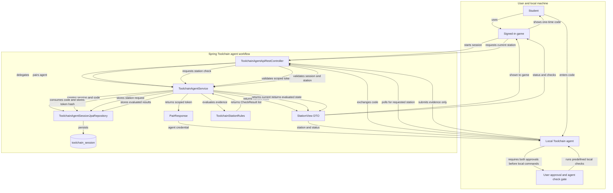

# Toolchain Architecture Guide

## Overview

Toolchain is the Java feature area for the CS Pathway learning experience. It supports three product concerns:

- Setup: collect and review evidence that a student's local development tools are ready.
- Scoring: record and display progress through the five learning levels.
- Help: let a student send a request to a teacher. This is a teacher help-request queue, not OCS chat. OCS chat is a possible future direction and is not implemented by this package.

| Area | Location or prefix | Notes |
| --- | --- | --- |
| Java implementation | `src/main/java/com/open/spring/mvc/toolchain/` | Toolchain Java classes are consolidated in the `mvc.toolchain` package. |
| Teacher dashboard | `src/main/resources/templates/cs-pathway/read.html` | The existing dashboard template remains in the `cs-pathway` folder. |
| Public routes | `/api/cs-pathway/...` and `/mvc/cs-pathway/...` | URL prefixes do not have to match the Java package; these routes remain unchanged for client compatibility. |

## Toolchain agent

The Toolchain agent is a separate local program on the student's computer; this Spring repository provides its REST API, session storage, and server-side evaluation rules, not the agent implementation. The agent performs predefined checks for the station selected in the game and submits evidence. Spring evaluates that evidence; it never executes local commands.

### Interactive session flow

Follow the API exchange from session creation through server evaluation and game status:

1. **Start pairing - game to Spring.** The signed-in game calls `POST /api/toolchain/sessions` with a `stationId`. Spring associates the session with the student's UID and returns a session UUID and one-time pairing code.
2. **Pair the local agent.** The student enters the code into the local agent. The agent exchanges it once at `POST /api/toolchain/pair`; Spring consumes the code and returns a bearer token scoped to that session.
3. **Request a station check - game to Spring.** As the student reaches a station, the game calls `POST /api/toolchain/sessions/{sessionId}/check`. Spring updates the current station for the paired agent.
4. **Get the request and submit evidence - agent to Spring.** The agent polls `GET /api/toolchain/sessions/{sessionId}/next` with its bearer token, runs only its predefined checks for the requested station, then submits check identifiers, exit codes, and output to `POST /api/toolchain/sessions/{sessionId}/results`.
5. **Evaluate and report - Spring to game.** Spring validates the agent token and requested station, evaluates evidence with `ToolchainStationRules`, and stores the results. The signed-in game reads the current station status and checks from `GET /api/toolchain/sessions/{sessionId}` as a `StationView`.

One pairing covers the trail, so the game can request later station checks without pairing again. Before running any local command, the agent must require both explicit student confirmation and its own confirmation that the requested station maps to predefined checks. Pairing is not blanket approval. This approval gate belongs to the local agent and is not enforced by the Spring API. The agent must not accept executable commands from the server.

Pairing codes and agent tokens are credentials: only their hashes are stored, and raw values must not be logged or shared. Their configured lifetimes are described below. The earlier macOS zsh shell helper is separate; it observes selected commands in an interactive shell but does not pair with the game or report station results.

### Pairing and station-check architecture

This flow is the agent-specific path through the otherwise shared Toolchain feature area. It is a reusable Web-to-Machine pairing pattern: authenticate the person in the web application, exchange a short-lived one-time code for a session-scoped machine credential, request bounded work, then evaluate submitted evidence on the server.

<!-- mermaid-checked: no \n, no em-dash/en-dash, no {} in labels, subgraphs are id["label"], arrows are -->|"label"|, all subgraphs closed by end, ids unique -->

`StationView` is the response shape for requesting a station check, agent polling, result submission, and game status polling. It carries the session identifier, current `stationId`, lifecycle `status`, and evaluated `List<CheckResult>`; it is not the agent's raw evidence. The local agent's predefined commands are outside this Spring repository. `ToolchainStationRules` defines the server-side station/check allow-list and evaluates the agent's submitted evidence; it does not execute or authorize local commands.

The pairing code currently expires after **5 minutes**, and the scoped agent token after **4 hours**, as configured by `toolchain.pairing-code-lifetime` and `toolchain.agent-token-lifetime` in `application.properties`. These bounded credential lifetimes are configurable; keep machine credentials scoped to one session and require re-pairing after expiry. Expiration does not automatically delete the persisted session or its results. If the agent-token lifetime is tightened, update the property and this documentation together.

## Two setup/report mechanisms

There are two setup mechanisms in the code. They should not be confused just because both use pairing codes:

| Mechanism | Java package and API | Purpose and persisted state |
| --- | --- | --- |
| Setup report | `mvc.toolchain`; `/api/cs-pathway/setup-report/...` | A terminal submits a plain-text verifier report. `ToolchainSetupReportEntity` stores the latest report keyed by student UID in `cs_pathway_setup_report`. An optional AI review summarizes the submitted evidence. |
| Interactive Toolchain Trail | `mvc.toolchain`; `/api/toolchain/...` | The game and a local agent exchange station-check requests and results. `ToolchainAgentSessionEntity` stores a UUID session linked to a student UID and the current station in `toolchain_session`. Spring evaluates the submitted evidence against station rules. |

Neither client writes directly to the SQL table. The game and local agent call Spring REST endpoints; the services validate identity, pairing credentials, station, and evidence, and then Spring repositories persist the resulting state. The student UID associates a session with its owner, but the interactive agent protocol also uses a session UUID, current `stationId`, a one-time pairing code, and a scoped agent token. Score `levelKey` values are a separate concept from Toolchain `stationId` values.

The interactive Toolchain Trail flow is the request/response approach for live station checks. The setup-report flow is a separate report-submission and review implementation that remains in the code. Source code confirms both are implemented; it does not establish whether the report flow is still used by students. Confirm usage with the game owner before deprecating it. Do not silently conflate their records or routes.

## Application layers

The package follows the Spring MVC and persistence pattern used by the rest of this application:

- REST controllers expose JSON or plain-text HTTP operations. They translate HTTP input and authentication into service calls and translate results or errors into HTTP responses. The routes are use-case endpoints; they do not provide full CRUD for every resource.
- DTOs are Java records used to exchange request and response data. Jackson maps JSON properties to record components and back. Records are transport shapes, not database tables.
- JPA entities are Java objects mapped to database rows. `ToolchainSetupReportEntity`, `ToolchainHelpRequestEntity`, and `ToolchainAgentSessionEntity` are feature-owned entities. Scores reuse the shared `Stats` entity.
- `JpaRepository` interfaces provide persistence operations and derived queries. They are the Java persistence interface, not a separate SQL database or a hand-written SQL layer.
- Services contain business rules and coordinate repositories or external systems. `ToolchainSetupReviewService` calls Gemini; the other services manage pairing reports, scores, help requests, agent sessions, and station rules.
- `ToolchainMvcController` serves the Thymeleaf teacher/admin page at `/mvc/cs-pathway/read`. It supplies dashboard data to `templates/cs-pathway/read.html`; this is a server-rendered UI route, not a REST endpoint.
- `ToolchainAgentApiRestController`, `ToolchainAgentService`, `StationView`, `ToolchainStationRules`, and `ToolchainAgentSessionEntity` implement the agent session lifecycle and station evidence evaluation.

## Current behavior

### REST operations

| Method | Route | Operation | Access |
| --- | --- | --- | --- |
| POST | `/api/cs-pathway/setup-report/pairing-code` | Issue or renew the signed-in student's terminal pairing code | Signed-in account |
| POST | `/api/cs-pathway/setup-report/{pairingCode}` | Submit plain-text verifier output | Public route; valid unexpired pairing code required |
| GET | `/api/cs-pathway/setup-report` | Read the signed-in student's latest report | Signed-in account |
| POST | `/api/cs-pathway/setup-report/review/{uid}` | Request an advisory AI review | Teacher or administrator |
| GET | `/api/cs-pathway/scores` | Read the signed-in student's level scores | Signed-in account |
| PUT | `/api/cs-pathway/scores/{levelKey}` | Record progress for one level | Signed-in account |
| POST | `/api/cs-pathway/help-requests` | Create a help request | Signed-in account |
| POST | `/api/toolchain/sessions` | Start an agent session and issue a pairing code | Signed-in account |
| POST | `/api/toolchain/pair` | Exchange a one-time code for a scoped agent token | Pairing code |
| POST | `/api/toolchain/sessions/{sessionId}/check` | Tell the paired agent which station to check | Session owner |
| GET | `/api/toolchain/sessions/{sessionId}/next` | Agent reads the current station request | Scoped agent token |
| POST | `/api/toolchain/sessions/{sessionId}/results` | Agent submits check evidence | Scoped agent token |
| GET | `/api/toolchain/sessions/{sessionId}` | Game reads the current session/check status | Session owner |

These routes provide reads and specific create/update actions. There is no delete endpoint, and not every resource offers all four CRUD operations.

The session UUID is not a student UID or a level key. The current pairing-code lifetime is 5 minutes and the agent-token lifetime is 4 hours; both are configurable in `application.properties`.

### Testing the REST API in VS Code

Use the VS Code REST Client extension with the two HTTP request files to exercise the API flows described above:

- [`api/cspathway.http`](../api/cspathway.http) tests the existing `/api/cs-pathway/...` compatibility routes for setup reports, help requests, and scores. Those routes remain unchanged even though the Java types now live in `mvc.toolchain`.
- [`api/toolchain.http`](../api/toolchain.http) tests the interactive `/api/toolchain/...` agent/session API, including start, pair, poll, result submission, and session status.

Select the `local` or `deployed` REST Client environment before sending requests. Authenticate first for endpoints requiring the signed-in game/student. The agent HTTP file deliberately submits failing sample evidence by default; only replace it with actual local check output and exit codes when testing a successful station check.

The files reference variables such as `baseUrl`, `adminUid`, and `adminPassword`. Define their values under `rest-client.environmentVariables` in `.vscode/settings.json`, which is excluded from Git. Keep credentials and other secret values in local settings only; do not copy them into the `.http` files, documentation, or commits. Treat pairing codes and agent tokens returned in responses as credentials. Use only an environment and account you are authorized to test.

### Setup report flow

1. A signed-in student calls `POST /api/cs-pathway/setup-report/pairing-code`. The response is a `ToolchainDtoSetupPairing` record with `code` and `expiresAt` (Unix epoch milliseconds). Codes are eight characters, expire after 30 minutes, and an active code for the student is reused with its expiration extended.
2. The student's local verifier sends its plain-text output to `POST /api/cs-pathway/setup-report/{pairingCode}`. This upload route is permitted without a login because the terminal does not have the browser's JWT cookie; the short-lived pairing code identifies the student. The service checks the report length and required summary lines before saving it.
3. The student reads their latest report from `GET /api/cs-pathway/setup-report`. When no report exists, the response contains null report fields.
4. A teacher or administrator can request an advisory review with `POST /api/cs-pathway/setup-report/review/{uid}`. `ToolchainSetupReviewService` sends the report to Gemini when `gemini.api.key` is configured. The model's response is checked and combined with verifier warnings and failures. This is an assessment of submitted text, not independent proof that software is installed.

The persisted record is keyed by student UID in `cs_pathway_setup_report`. It stores the current pairing code and expiry, the latest verifier status and counts, the raw report, and its submission time. Timestamps are epoch milliseconds.

### Scoring flow

- A signed-in student reads progress with `GET /api/cs-pathway/scores`.
- The student records progress with `PUT /api/cs-pathway/scores/{levelKey}` and a JSON body such as `{"percentComplete": 60}`. The server derives the student UID from the authenticated principal rather than accepting it from the body.
- `ToolchainEnumLevels` defines the five stable level keys and their `submodule` numbers. Those numbers identify rows in the shared `Stats` table where `module` is `cs-pathway`; do not renumber them after data has been written.
- Progress is constrained to 0 through 100 and only moves forward. Missing levels are returned as zero percent. A level is finished at 100 percent.
- The teacher page combines score rows, setup reports, and recent help requests.

### Help-request flow

- A signed-in student submits `POST /api/cs-pathway/help-requests` with `levelKey`, optional `station`, and `message`.
- The service validates the level and text lengths, then stores a request in `cs_pathway_help_request`. A student can submit at most one request per minute.
- The teacher/admin dashboard shows up to the 200 most recent requests at `/mvc/cs-pathway/read`.

## Persistence and security

- `cs_pathway_setup_report`, `cs_pathway_help_request`, and `toolchain_session` are initialized by `ToolchainSetupReportTableInitializer`, `ToolchainHelpRequestTableInitializer`, and `ToolchainAgentSessionTableInitializer`. These `ApplicationRunner` components are needed because Hibernate uses `ddl-auto=none`. Keep their DDL and corresponding entity mappings aligned for both SQLite and MySQL.
- Score data is stored in the shared `Stats` table. Pathway queries are isolated in `ToolchainJpaRepositoryStats`; do not create a second score table without a deliberate data migration.
- Interactive station sessions are stored in `toolchain_session`; this is separate from score rows and setup-report rows because it has its own pairing, token-expiry, station-request, and result lifecycle. `ToolchainStationRules` is the server-side allow-list and evaluator; a client must not determine its own pass/fail result.
- The server evaluates submitted check evidence but never runs commands on a student's machine. The external local agent must map station requests to predefined checks and require both explicit student approval and its own safety confirmation before executing any local command. Pairing alone must not authorize arbitrary command execution.
- The score and help endpoints use the authenticated student principal. The pairing-code issue route and AI review route have explicit role rules. The text report upload is public at the HTTP layer and relies on a valid, unexpired pairing code in the service. The MVC dashboard is restricted to teachers and administrators. See `SecurityConfig` and `MvcSecurityConfig` for the actual access rules.
- Toolchain pair, poll, and result routes are public at the Spring Security matcher layer because the local agent has no browser JWT cookie; `ToolchainAgentService` requires a valid one-time pairing code or the session's scoped, unexpired bearer token. The game session routes require the signed-in owner.
- Treat pairing codes and agent tokens as credentials: keep them random, short-lived, validated on every use, and out of logs. Avoid logging raw verifier reports or command output, which may contain local machine details.

## Package organization and naming

The Java types are consolidated under `mvc.toolchain` so students can discuss scores, help requests, setup reports, and interactive station checks in one place. The files use feature-first, role-suffix names such as `ToolchainHelpRequestEntity`, `ToolchainHelpRequestService`, and `ToolchainHelpRequestTableInitializer`. API controllers, DTOs, and repositories retain their established role names. The Java type renames do not change API routes or database tables.

The public routes retain both `/api/cs-pathway` and `/api/toolchain` prefixes. Those names are part of the existing game/agent contract and are deliberately not renamed along with Java packages and files. Renaming routes or database tables should be a separate, coordinated migration that updates external game/agent clients and persisted data as needed.

If the report-upload mechanism is no longer used, first confirm that its UI, REST clients, scripts, and saved reports are no longer needed. Then plan deprecation/removal separately instead of folding it into a package move.

The macOS zsh shell helper discussed alongside this feature is yet another separate piece: it watches selected commands in an interactive shell and can show local help, but it does not call `/api/toolchain`, pair with the game, or submit station results. It should not be confused with the local Toolchain Trail API agent.

## Change and documentation checklist

When extending CS Pathway or Toolchain Trail:

1. Keep responsibilities in their existing layer: HTTP handling in controllers, business rules in services, transport shapes in records, and table mappings in entities.
2. Keep API routes, DTO component names, HTTP status behavior, and security rules consistent. Update callers and tests when a JSON contract changes.
3. Keep the enum keys and score submodule numbers stable. Update both entity mappings and table initializer DDL when changing persisted columns.
4. Add or update focused JUnit/Mockito tests for the service behavior and controller contract where applicable.
5. Add plain-language JavaDoc to each new Java type and to public methods whose behavior or constraints are not obvious. Keep JavaDoc readable in the source editor; do not put HTML or Markdown diagrams in comments.
6. Update this guide when the architecture or observable behavior changes. The repository `README.md` and `AGENTS.md` link here so people and coding agents can find it.
