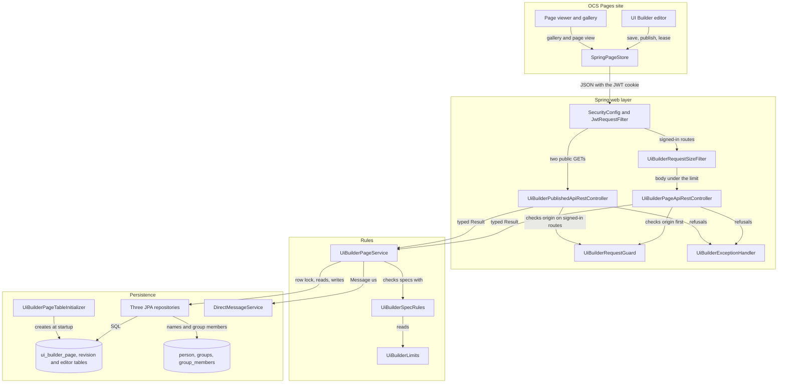
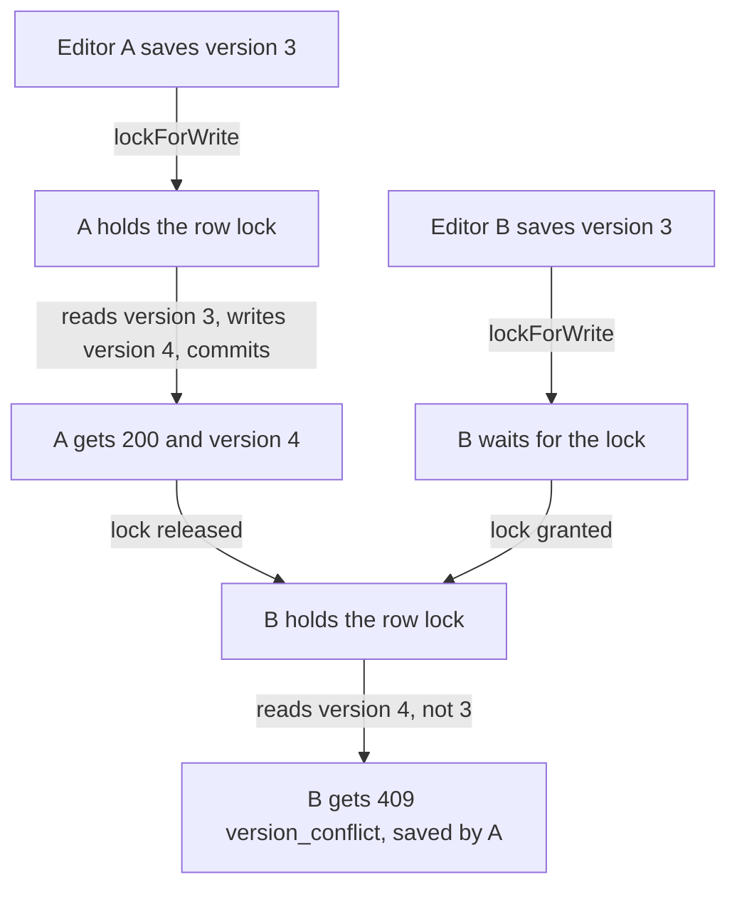

# UI Builder Architecture Guide

## Overview

The UI Builder on the OCS Pages site (`_projects/systems/ui-builder` in pages) lets a student build a page from sections and blocks: text, images, buttons, their team's chat and board, data from their own Flask API. The page is a JSON document (a **spec**), never HTML. Spring stores the specs, decides who may edit and see each page, and serves published pages:

- **Drafts**: every editor saves the draft. Spring keeps earlier copies as revisions.
- **Published copy**: publishing copies the draft, without its hidden sections and blocks, to an address `/ui-builder/view/?page=<slug>`. Signed-in OCS members can open it.
- **Approved copy**: a teacher approves one published copy for everyone (PUBLIC), so visitors who aren't signed in, such as guests at Night at the Museum, can open it. Later publishes don't reach them until a teacher approves again.

Spring never renders a spec. The page renderer in Pages turns it into OCS components through an allow-list; Spring's checks (`UiBuilderSpecRules`) are a second line behind it.

| Area | Location | Notes |
| --- | --- | --- |
| Java implementation | `src/main/java/com/open/spring/mvc/uibuilder/` | The parts below. |
| Tests | `src/test/java/com/open/spring/mvc/uibuilder/` | Rules, service, HTTP contract, table initializer, SQLite persistence. |
| Shared fixtures | `src/test/resources/ui-builder/` | `all-blocks.json` and `invalid/*.json`, copied byte for byte into Pages. |
| HTTP tests | `api/ui-builder.http` | Every route, for the VS Code REST Client. |
| Public routes | `/api/ui-builder/...` | A contract with the Pages store (`spring-page-store.js`). |

## The parts

The package follows the `mvc/toolchain` layout, with a few more parts because pages have three tables and two kinds of caller (editors and viewers):

| File | Job |
| --- | --- |
| `UiBuilderPageApiRestController` | The signed-in routes: pages, drafts, publishing, visibility, revisions, the editing lease. Holds their DTO records. |
| `UiBuilderPublishedApiRestController` | Published pages: the public gallery and page view, and the signed-in "Message us" and members routes. Holds their DTO records. |
| `UiBuilderPageEntity`, `UiBuilderPageRevisionEntity`, `UiBuilderPageEditorEntity` | One row each of `ui_builder_page`, `ui_builder_page_revision` and `ui_builder_page_editor`. |
| `UiBuilderPageJpaRepository`, `UiBuilderPageRevisionJpaRepository`, `UiBuilderPageEditorJpaRepository` | Read and write the tables. Lists use projections, so they never load specs. |
| `UiBuilderPageService` | The rules: who may edit and see a page, versions, publishing, groups, leases, revisions. |
| `UiBuilderSpecRules` | Pure checks of a spec (no database), plus helpers such as `stripHidden`. |
| `UiBuilderPageTableInitializer` | Creates the tables and indexes at startup, because `ddl-auto` is `none`. |
| `UiBuilderRequestGuard` | Lets only the OCS pages call the signed-in routes. |
| `UiBuilderRequestSizeFilter` | Refuses request bodies over 1 000 000 bytes. |
| `UiBuilderLimits` | The document limits, from `ui-builder.limits.*`. |
| `UiBuilderException`, `UiBuilderExceptionHandler` | Errors as JSON `{"error": code, ...}`; `statusOf` maps each service outcome to its HTTP status. |

<!-- mermaid-checked: no \n, no em-dash/en-dash, no {} in labels, subgraphs are id["label"], arrows are -->|"label"|, all subgraphs closed by end, ids unique -->

## Who may do what

- **Editors** are the page's owner, every teacher and admin (`ROLE_TEACHER`, `ROLE_ADMIN`), and the people in `ui_builder_page_editor`. Those rows are copied from the page's group when its owner or a teacher sets the group (or presses refresh, `POST /pages/{id}/editors/refresh`). Group membership is never checked at request time, so joining a group yourself grants nothing.
- Someone who can't edit a page gets **404 for every page route**, never 403, so ids don't reveal which pages exist. An editor who may not do one thing (a teammate deleting the page, or changing its group) gets 403.
- A page's **group** must be one the caller is in (teachers needn't be), and never a class group (`courses.class-groups` in `CourseGroupProperties`) or a course channel (`lessons`, `*-announcements`, `*-week-*`). Otherwise 400 `invalid_group`.
- A **chat or members block** names a group in its spec. On every save Spring checks each one exists and isn't a class group or course channel, and rewrites its name to Spring's. A group the caller adds must be one of theirs (teachers excepted); a group already on the stored draft was checked when it was added, so it doesn't stop a teammate from saving. Otherwise 400 `invalid_spec` with `{"nodeId", "field": "group", "key": "group_not_allowed"}`.
- **Viewers**: signed-in members see every published page; anonymous visitors only a page approved for everyone whose `publicUntil` hasn't passed, as approved. Anonymous views never include a person's name, uid, email or id.

## Saving safely: the row lock and versions

Each page row has a `draft_version`. The editor sends the version it started from; a save of an older version is refused with 409 `version_conflict` and who saved last, and the editor offers "Reload theirs" or "Keep mine" (the other version stays in Revisions). `draft_version` changes only when a draft is saved or restored. There is no JPA `@Version`.

Every write is one `@Transactional` service method whose **first statement** is the no-op `UPDATE ui_builder_page SET draft_version = draft_version WHERE id = ? AND deleted_at IS NULL` (`lockForWrite`; 0 rows means 404). SQLite has no `SELECT ... FOR UPDATE`, and a transaction that reads first fails with `SQLITE_BUSY` when another write commits before it writes. Taking the lock first makes the second writer wait, then see the first one's save and get a clean 409. The same pattern guards grading (`AssignmentSubmissionJPA.lockForGrading`). A refused write is rolled back. The caller's account is looked up before the transaction starts, and creating a page inserts its row before it reads any group, so no write transaction reads before it writes.

<!-- mermaid-checked: no \n, no em-dash/en-dash, no {} in labels, subgraphs are id["label"], arrows are -->|"label"|, all subgraphs closed by end, ids unique -->

## Publishing, visibility and slugs

- The first publish needs a **slug**, the page's address. It must match `ui-builder.limits.slug-pattern`, not be in `reserved-slugs`, and be free (400 `slug_required`, `invalid_slug`, `slug_reserved`; 409 `slug_taken`). After that it is fixed: a different slug is 409 `slug_locked`. A deleted page keeps its slug, so an address never points at a different page later. The check runs inside the row lock; on MySQL, where two pages can lock at once, the `UNIQUE` column catches the race and the handler answers `slug_taken`.
- Publishing copies the draft without hidden nodes (`stripHidden`) to `published_spec` and the draft version to `published_version`, and records a PUBLISH revision. A draft may read an API on the team's own computer (`http://localhost`); a published page can't (400 `loopback_source`).
- `POST /pages/{id}/visibility`: PUBLIC from a teacher copies the published copy to `public_spec` (with `public_version` and an optional `until`); from anyone else it only sets `public_requested`. SIGNED_IN clears the approval and the request. `POST /pages/visibility/bulk` approves every published page of a course in one statement. Unpublishing also clears the approval. Visibility changes and teacher deletes are logged with the actor's uid, at warn because production logs at warn.

## REST operations

Base `/api/ui-builder`. Every route except the two public GETs first passes `UiBuilderRequestGuard`: `X-Origin: client`, an `Origin` from `ui-builder.allowed-origins`, and `Content-Type: application/json` on writes, else 403 `origin_rejected`. Ids are numbers (`{id:\d+}`).

| Method | Route | Body | Answer |
| --- | --- | --- | --- |
| GET | `/pages?scope=mine` | | `PageSummary[]`: pages the caller owns or edits |
| GET | `/pages?scope=class&course=` | | teachers: `PageSummary[]`, newest first, at most 500; others 403 `forbidden` |
| POST | `/pages` | `CreateRequest` `{title, spec, description?, byline?, course?, image?, groupId?}` | 201 `PageDetail`, slug null |
| GET | `/pages/{id}` | | `PageDetail` |
| PUT | `/pages/{id}` | `SaveRequest` `{version, spec, title?, ..., groupId?}` | `PageDetail`, or 409 `version_conflict` |
| DELETE | `/pages/{id}` | | 204 (owner or teacher): soft delete |
| POST | `/pages/{id}/publish` | `{version, slug?}` | `PageDetail` |
| POST | `/pages/{id}/unpublish` | | `PageDetail` |
| POST | `/pages/{id}/visibility` | `{visibility, until?}` | `PageDetail` |
| POST | `/pages/visibility/bulk` | `{course, until}` | teachers: `{updated}` |
| GET | `/pages/{id}/revisions` | | `[{revisionId, pageVersion, kind, savedByName, savedAt}]`, newest first |
| GET | `/pages/{id}/revisions/{revisionId}` | | the same with `spec` |
| POST | `/pages/{id}/revisions/{revisionId}/restore` | `{version}` | `PageDetail` (a new draft version; never publishes) |
| POST | `/pages/{id}/lease` | | `{holderName, expiresAt, mine}` |
| POST | `/pages/{id}/lease/take` | | the same, taken from whoever held it |
| DELETE | `/pages/{id}/lease` | | 204 |
| POST | `/pages/{id}/editors/refresh` | | `PageDetail` (owner or teacher) |
| GET | `/slug-available?slug=` | | `{slug, available, reason?}` (advisory) |
| GET | `/my-groups` | | `[{id, name}]`, without class groups and course channels |
| GET | `/published?course=` | | **public**: `GalleryItem[]`, newest first, at most `gallery-max` |
| GET | `/published/{slug}` | | **public**: `PublishedView`, or 404 `not_found` |
| POST | `/published/{slug}/message-owner` | | `{conversationId}` (not for the owner: 400 `own_page`) |
| GET | `/published/{slug}/members/{blockId}` | | `[{name}]`; 404 unless that block is a members block on the published page |

`PageSummary` is `{id, slug, title, description, byline, course, image, status, visibility, publicRequested, publicUntil, publicPending, groupId, groupName, ownerName, isOwner, version, updatedAt, updatedByName, publishedAt, publishedVersion, hasUnpublishedChanges, lease}`; `PageDetail` adds `spec` (the draft). `version` is the draft version to send back. `publicPending` means the page is public but its newest publish isn't the approved one. Times are epoch milliseconds; specs are JSON objects.

`PublishedView` is `{slug, title, description, byline, course, image, publishedAt, publishedVersion, visibility, spec, canEdit, pageId?, madeBy: {owner?, group?}, groups: {"<id>": {name, viewerIsMember}}, viewer: {signedIn, name?}}`. Its title, description, byline and picture come from the copy the viewer gets (so an anonymous visitor never sees an unapproved title), and so do the gallery cards. `viewerIsMember` lets the viewer decide whether to show a chat; it is not access control (see Known issues).

Errors are `{"error": code, ...}`: `invalid_spec` adds `details: [{nodeId, field, key}]`, and `version_conflict` adds `currentVersion`, `savedByName` and `savedAt`. Unreadable JSON is 400 `invalid_spec`, an id too big for a number 404, a body that isn't JSON 403 `origin_rejected`, a lock not granted in time 409 `busy`, a body over the limit 413 `too_large`.

Test them with the VS Code REST Client and [`api/ui-builder.http`](../api/ui-builder.http). It uses the `baseUrl`, `adminUid` and `adminPassword` variables of `toolchain.http` (set in the Git-ignored `.vscode/settings.json`), names its test page for 2099, and deletes it at the end.

## What Spring checks in a spec

`UiBuilderSpecRules.validate` (the editor's validator applies the same rules, and both run the shared fixtures):

- The envelope: `schemaVersion` 1, `kind` `ocs-ui-page`, an object `page` and an array `sections`.
- Size and depth: the spec as Jackson writes it is at most `spec-chars` (200 000) characters, and at most `depth` (12) levels deep, counting every object and array, the page itself as 1.
- Structure: at most 25 sections, 3 cells per section, 50 blocks per section and 8 shown live blocks (chat, members, message_me, kanban, feedback, announcements, calendar, api_data); ids match `^[sb]-[a-z0-9]{6,12}$` and are unique; types match `^[a-z][a-z0-9_]{1,31}$`.
- Keys: none starting with `on` (any case), none named `html`, `script` or `__proto__`. Every string is at most 20 000 characters.
- Values by key, the convention the Pages registry follows:
  - `url`, `src`, `image`, `link` hold "" or an `https://` address (no `user:password@`, no whitespace, control, invisible or direction characters, no backslash), a path on the site (`/` but not `//`), `mailto:` (only a button's `url` in `links`), or, in a draft, `http://localhost` or `http://127.0.0.1`. A published page refuses any address on the student's own computer.
  - `body` (rich text) holds no `<script`, `<iframe`, `<object`, `<embed`, `javascript:` or `on...=` handler inside a tag, after character references are decoded and whitespace and control characters removed.
  - keys ending `_path` match `^[A-Za-z0-9_.\[\]-]{0,120}$`.
  - a `snapshot` (an API block's saved copy) is null or `{items, fetched_at, from_loopback}`, with at most 50 items of only title, text, image, link, value and label (strings up to 500 characters), and at most 64 000 characters in all.
- Page settings (also kept in columns): a one-line title up to 120 characters, description up to 300, byline up to 120, course "" or a class group in lower case (`csp`), a gallery picture that is `https://` or a site path. Spring writes these into the spec's `page` object too, so every stored copy carries its own title.

## Persistence

`UiBuilderPageTableInitializer` creates three tables with `CREATE TABLE IF NOT EXISTS` (SQLite and MySQL, the same Dialect record as `CalendarEventTableInitializer`) and five indexes, each in its own try because MySQL has no `CREATE INDEX IF NOT EXISTS`. There are no foreign keys; entities hold plain ids.

| Table | Holds |
| --- | --- |
| `ui_builder_page` | slug (UNIQUE, null until published), title, description, byline, course, image, owner and group ids, status (DRAFT, PUBLISHED, DELETED), visibility (SIGNED_IN, PUBLIC), the public request and expiry, the draft, published and approved specs with their versions, times, who saved last, the lease, `deleted_at` |
| `ui_builder_page_revision` | earlier drafts: page id, page version, kind (SAVE, PUBLISH, RESTORE), spec, who saved it and when |
| `ui_builder_page_editor` | (page id, person id), UNIQUE: the editors copied from the page's group |

Specs are stored as text written by Jackson (`mediumtext`), never as a JSON column. Revisions: a save goes into the newest revision when that is a SAVE by the same person started less than ten minutes ago, otherwise it starts a new one; Spring keeps the newest 30 SAVE rows and every PUBLISH and RESTORE, at most 50 per page, pruned in the same transaction. A soft delete sets status DELETED, empties the specs and removes the revisions and editors, but keeps the row and its slug.

## Testing

- `JAVA_HOME=$(/usr/libexec/java_home -v 24) ./mvnw -q test -Dtest='UiBuilder*Test'`
  - `UiBuilderSpecRulesTest`: every rule, and the shared fixtures: `all-blocks.json` (every block type with every field, every column layout, the deepest nesting allowed) passes; each `invalid/*.json` fails for its own rule (`*-on-publish.json` only when published).
  - `UiBuilderPageServiceTest`: the rules over an in-memory store (`UiBuilderTestStore`) with a fixed clock: 404s, versions, publishing and `stripHidden`, the approved copy, groups and editors, leases, revisions kept.
  - `UiBuilderApiHttpTest`: routes, the guard, JSON field names and status codes through both controllers (standalone MockMvc), and the size filter.
  - `UiBuilderPageTableInitializerTest`: the tables, defaults, unique columns and indexes on in-memory SQLite, twice.
  - `UiBuilderPersistenceTest`: every query on a real SQLite file with `ddl-auto=none`, a refused create rolled back, and writers saving one version at once: exactly one save, the rest 409, no `SQLITE_BUSY`.
- After `./mvnw spring-boot:run`: anonymous `GET /api/ui-builder/published/x` answers 404 JSON (not 401), and anonymous `POST /api/ui-builder/pages` 401. Then `api/ui-builder.http`.

## Known issues

- **Group chat has no membership check in Spring.** `viewerIsMember` only decides whether the viewer shows a chat block; the group chat routes and STOMP topics don't check membership (see [group-chat-architecture.md](group-chat-architecture.md)). The UI Builder adds no new way in, but it doesn't close this gap.
- **Editors don't follow the group by themselves.** People who join or leave a group become or stop being editors only when the owner or a teacher refreshes (by design: self-join grants nothing).
- **Saved API copies are public text.** A published page carries its API block's saved copy, so anything the team's API returned is visible to viewers. The editor hides fields that look private, but Spring only checks the shape and size.
- **The editing lease is advisory.** Two editors can still both edit; the version check stops one from overwriting the other silently.
- **A revision's savedAt is when it was started.** Saves within ten minutes go into one revision, which shows the time of its first save.
- **On SQLite, a unique-column error isn't a DataIntegrityViolationException.** Hibernate's SQLite dialect reports it as a generic JDBC error, so the `slug_taken` mapping is for MySQL; on SQLite the slug check inside the write lock catches it first.

## Change checklist

1. Keep the limits in `application.properties` (`ui-builder.limits.*`), `UiBuilderLimits` and the Pages registry (`data/ui_builder.yml`) equal.
2. Change a spec rule in `UiBuilderSpecRules` and in the editor's validator together, and add or update a shared fixture in both repos (`src/test/resources/ui-builder/` here, `tests/fixtures/` in the UI Builder project), byte for byte.
3. Keep routes, DTO component names, error codes and status codes stable; the Pages store reads them. A new outcome needs a case in `UiBuilderException.statusOf`.
4. New writes start with `lockForWrite` (or, for a new row, the INSERT) before any read, and refuse through `refuse(...)` so nothing they did is kept.
5. New columns go into the entity and `UiBuilderPageTableInitializer` together, with an `ALTER TABLE ... ADD COLUMN` for existing tables.
6. Update this guide, `api/ui-builder.http` and the tests with any change in behavior. `README.md` and `AGENTS.md` link here.
