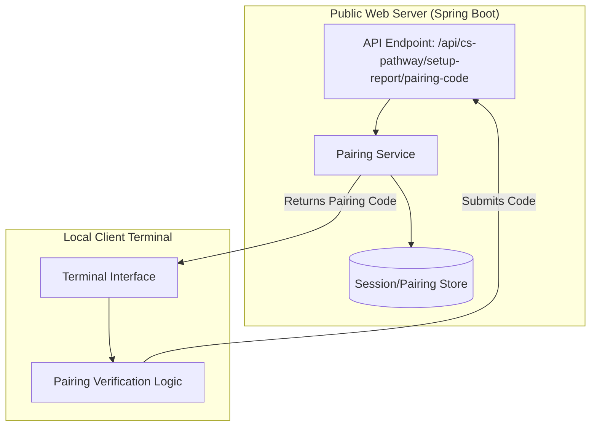

# CS Pathway Pairing Architecture

## Overview

The CS Pathway pairing mechanism is a core component of the gamified experience, designed to bridge the gap between a public-facing web server and a local client terminal. This pairing ensures that the user's progress and interactions in the web interface are synchronized with their local development environment.

## Architecture Diagram

## Component Details

### 1. Pairing Code Generation
The server generates a unique, short-lived alphanumeric code. This code is encapsulated in the `CsPathwayPairingCode` record.

- **Endpoint**: `POST /api/cs-pathway/setup-report/pairing-code`
- **Response Model**: `CsPathwayPairingCode`
    - `code`: A unique string used for identification.
    - `expiresAt`: A timestamp defining the window of opportunity for pairing.

### 2. Pairing Flow

1. **Initiation**: The user starts the experience on the web server.
2. **Code Retrieval**: The web server generates a `CsPathwayPairingCode` and presents it to the user.
3. **Terminal Input**: The user enters this code into their local client terminal.
4. **Verification**: The terminal sends the code back to the server via a secure endpoint.
5. **Session Linkage**: Upon successful verification, the server links the web session with the terminal session.

## Extension Guidelines for Developers & AI

### Adding New Pairing Methods
If you wish to add alternative pairing methods (e.g., QR codes or OAuth-based pairing):
1. **Define New Models**: Create new records/classes for the new pairing data.
2. **Update Service Layer**: Implement the logic to generate and validate the new tokens.
3. **Expose Endpoints**: Add new REST controllers to handle the new flow.
4. **Update Documentation**: Ensure the `CsPathwayPairingCode` pattern is followed for consistency.

### Security Considerations
- **Code Entropy**: Ensure pairing codes have sufficient randomness to prevent brute-force attacks.
- **Expiration**: Always enforce the `expiresAt` constraint on the server side.
- **Rate Limiting**: Implement rate limiting on the verification endpoint to prevent automated guessing.

### AI Implementation Instructions
When generating code to extend this service:
- **Follow the Record Pattern**: Use Java Records for DTOs (Data Transfer Objects) to maintain immutability and conciseness.
- **Maintain Javadoc Style**: Use plain-text Javadoc comments for all new components.
- **Respect the Two-Port Architecture**: Remember that the web server and websocket components may operate on different ports (8585 and 8589).
